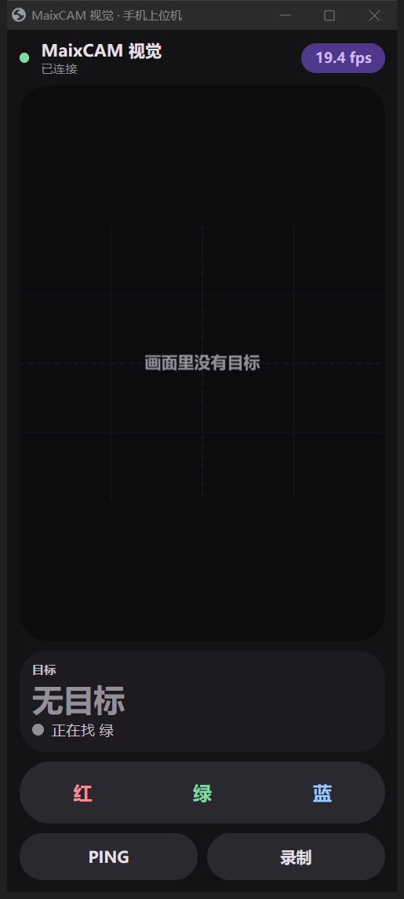

# MaixCAM 颜色物块追踪 —— 相机 + 主控联调工程

智能搬运比赛项目：**相机负责"看"，STM32 负责"动"**。

相机识别目标颜色的物块 / 色环，把"是否存在 / 颜色 / 是块还是环 / 中心像素坐标 / 尺寸"
按 **640×480 像素坐标**打成 20 字节串口帧；STM32 拿坐标做"居中 + 抵近"，
并在自己的流程里决定抓哪个、放到哪个环、什么时候动。

- 协议定稿：[相机_主控串口通信协议_定稿.md](相机_主控串口通信协议_定稿.md)
- 硬件：MaixCAM（SG2002）+ STM32H723ZGT6

---

## 1. 目录结构

```
E:\maxican\
├─ 相机_主控串口通信协议_定稿.md        协议定稿（唯一基准，三套实现都对齐它）v4
├─ 现场使用手册.md                      **装到车上真正跑起来的操作手册（先看这个）**
├─ 搬运任务模式.md                      **比赛规则对照 + 本地演示模式（正式流程已移到 STM32）**
├─ 现场测试清单.md                      **上机实测的分阶段流程（每步都有通过标准）**
├─ 附件1-智能搬运比赛规则1018 (1).docx   比赛规则原文
├─ device_test_report.md                真机验证报告（实测数据、踩坑记录）
├─ README.md                            本文件
├─ camera\
│   ├─ maixcam_color_tracker.py         相机端主程序（MaixPy，单文件，唯一源文件）
│   ├─ vision_selftest.py               真机自检：用标准色图验证环/块判定
│   ├─ probe_shape.py                   形状判据探针（density/solidity/roundness）
│   ├─ probe_api.py                     MaixPy 接口能力探针
│   ├─ bench_probe.py                   性能分解
│   └─ uart1_selftest.py               UART1 收发自检（回环/监听）
├─ app\
│   ├─ build_app.ps1                    打包脚本：把上面的源码复制成应用包
│   ├─ make_icon.py                     生成菜单图标
│   └─ color_tracker\                   应用包（app.yaml + main.py + app.png）
├─ pc\
│   ├─ protocol.py                      协议纯逻辑（组帧/解帧/流式解析，无依赖）
│   ├─ ground_station.py                **上位机图形界面**（实时画面框/目标信息/选色命令/CSV）
│   ├─ serial_monitor.py                上位机命令行版（CH340 联调用）
│   ├─ serial_capture.ps1               不依赖 pyserial 的串口抓包（.NET 串口）
│   ├─ field_test.ps1                   **现场一键工具**（部署/运行/拉图/改配置/重启）
│   ├─ mobile\index.html                **手机端页面**（浏览器打开，不用装 App）
│   ├─ watch_ports.py                   盯串口插拔并自检能否写入
│   ├─ build_release.ps1                打包脚本：生成 release\智能搬运上位机\ 便携版
│   ├─ 打包上位机.bat                   ↑ 双击跑（省得记 powershell 命令）
│   ├─ release_tpl\                     便携版的启动器 bat / 使用说明模板（改文案改这里）
│   └─ make_ring_test.py                生成环/块标准色图（给 vision_selftest 用）
├─ release\
│   ├─ 智能搬运上位机\                  **便携版：整包拷到别的电脑，双击 bat 就跑**
│   └─ 智能搬运上位机.zip               同上，压缩包（发给别人用）
├─ stm32\
│   ├─ mx_protocol.h                    主控侧协议接口（纯 C，不依赖 HAL）
│   ├─ mx_protocol.c                    主控侧协议实现（流式解析 + 组帧）
│   └─ host_test.c                      PC 端单元测试（gcc 就能跑）
└─ tests\
    ├─ test_protocol.py                 Python 跨实现一致性测试
    ├─ test_mission.py                  搬运任务逻辑（状态机/形状判定/配置）
    ├─ test_vision_sim.py               视觉链路仿真（假图像跑真代码）
    ├─ fake_camera.py                   模拟 MaixPy image 的假相机
    └─ ring_test.png                    标准色图
```

同一份协议有**三套独立实现**（相机端 Python / 上位机 Python / 主控 C），
测试以协议文档里的示例帧为唯一基准逐个比对，防止"看起来都发了，就是对不上"。

---

## 2. 接线

| MaixCAM | 方向 | STM32H723 |
| --- | --- | --- |
| `A19`（UART1_TX） | → | 所选 USART 的 `RX` |
| `A18`（UART1_RX） | ← | 所选 USART 的 `TX` |
| `GND` | — | `GND`（必须共地） |

- 双方都是 3.3V TTL，**直连即可**，不要接 5V。
- ⚠ **不要用 UART0**（`A16`/`A17`，`/dev/ttyS0`）：那是系统终端与开机日志串口，
  而且 `A16` 是芯片启动模式检测脚，**被外部拉低会导致 MaixCAM 开不了机**。
- MaixCAM 的 USB 口是 USB 网络/存储功能，不是 USB 转串口，不能当串口用。

---

## 3. 部署相机端

### 3.1 跑起来

1. 用 MaixVision 打开 `camera/maixcam_color_tracker.py`，直接运行。
2. 屏幕上会显示当前追踪颜色、目标框和帧率。v4 帧里**没有帧序号**，丢帧只能看帧率。
   ⚠ 当前屏幕叠加层/日志**还没完全迁到 v4**：代码里仍会打印 `xn/yn/seq` 等旧字段；
   **坐标以上位机或串口解析结果为准**（`serial_monitor.py` / `ground_station.py`），
   屏幕字段待后续统一。
3. 退出程序后系统会自动回到桌面启动器，**不会黑屏**。

程序上电默认按 `CONFIG["default_color"]`（默认红）持续上报，
收到主控的 4 字节选色命令（`AA BB 01/02/03 FF`）后立即切换，之后一直按这个颜色识别。
v4 **没有 `SAVE` 命令**：要持久化颜色/帧率就改配置文件 `/root/color_tracker_cfg.json`，
或者在触摸界面按 `SAVE`（只写颜色、帧率、阈值等，不涉及协议）。

程序支持在设备上（SSH）直接用命令行参数覆盖配置，便于分阶段上机调试：

```bash
python3 -u maixcam_color_tracker.py                      # 正常跑
python3 -u maixcam_color_tracker.py --duration 15        # 跑 15 秒后自动优雅退出
python3 -u maixcam_color_tracker.py --no-display         # 不开屏幕（SSH 调试推荐）
python3 -u maixcam_color_tracker.py --no-uart            # 不开串口（只验视觉）
python3 -u maixcam_color_tracker.py --test-full          # 全范围阈值自检几何换算
python3 -u maixcam_color_tracker.py --color green --fps 20
```

> **为什么要有 `--duration`**：设备上**没有 `timeout` 命令**（BusyBox 未编入），
> 而且不要用 `SIGKILL` 打断正在用摄像头的程序（容易把 ISP/VI 驱动留在半开状态）。
> 让程序自己退，才能走正常流程、干净释放驱动。

### 3.2 用 SSH 上机（USB 虚拟网卡）

设备插上 USB 后是一块虚拟网卡，**设备 IP = 电脑 IP 最后一段改成 1**：

| 网卡 | 电脑 | 设备 |
| --- | --- | --- |
| `UsbNcm Host Device` | 10.171.126.100 | **10.171.126.1** |
| `Remote NDIS based Internet Sharing Device` | 10.171.127.100 | **10.171.127.1** |

两个地址任选其一，默认用户/密码都是 `root`。上传与运行：

```powershell
scp camera\maixcam_color_tracker.py root@10.171.126.1:/root/
ssh -n root@10.171.126.1 "python3 -u /root/maixcam_color_tracker.py --duration 15 --no-display --no-uart"
```

⚠ **要开屏幕，必须先停启动器**，否则 `display.Display()` 会卡住，
并且会把 `/proc` 读取一起堵死（`ps`、`killall` 全部挂起），只能重启设备恢复：

```powershell
ssh -n root@10.171.126.1 "killall launcher_daemon launcher maixvision_server ; sleep 3 ; nohup python3 -u /root/maixcam_color_tracker.py --duration 12 --no-uart > /tmp/t.log 2>&1 < /dev/null &"
# 恢复界面
ssh -n root@10.171.126.1 "sync ; sleep 1 ; /sbin/reboot -f"
```

（MaixVision 连接设备时也是先让启动器退出，只是它自动帮你做了。）

> 两个 Windows 侧的小坑：`ssh` 在 PowerShell 5.1 下会等 stdin 不返回，**加 `-n`**；
> 远程命令别带双引号，PS 5.1 会把它们吃掉。

### 3.3 真机实测结果

见 [device_test_report.md](device_test_report.md)（v2/v3 历史实测）和协议定稿 §5（v4 帧率）。摘要：

| 测试 | 结果 |
| --- | --- |
| 视觉链路 640×480 | v4 稳定 **14~16 fps**（瓶颈是 `find_blobs`，`SET_FPS` 已取消） |
| 几何自检 `--test-full` | 整幅画面按 v4 换算应为**中心 (320,240)、w=640、h=480 像素**（旧报告里的 `xn=128 yn=128 wn=255 hn=191` 是 v3 归一化时代的数据，**待 v4 真机复测**） |
| 串口 `/dev/ttyS1` | 旧版记录 8 秒 232 帧、坏帧 0；v4 帧长 20 字节，建议用 `pc\serial_monitor.py` 复核 |
| 退出 | 每次都打印 `maix multi-media driver released.`，驱动正确释放 |

### 3.4 标定颜色阈值（**必须做，别跳过**）

代码里 `THRESHOLDS` 的红/绿/蓝是 **MaixPy 官方文档给的入门值**，
实机上光照一变就不准，一定要重新标。用设备**自带的「找色块」应用**最快：

1. 打开设备上的「找色块」应用；
2. 摄像头对准物块，**点屏幕上的物块**，左侧会显示该颜色的 LAB 值和矩形框；
3. 点那个矩形框 → 自动生成阈值；再进配置模式手动微调 L/A/B 的 min/max；
4. 把得到的 6 个数字按 `[L_min, L_max, A_min, A_max, B_min, B_max]` 填进 `THRESHOLDS`。

> **更正一处我之前的说法**：我早前说"红色在 LAB 里色相跨界、阈值要拆成两段"——
> 那是把 HSV 色相环的经验错套到 LAB 上了。MaixPy 用的 LAB 里红色是 A 通道的正大值，
> **单段就够了**（官方给的就是 `[[0,80,40,80,10,80]]`）。要拆两段的情况是同一个颜色
> 因光照分裂成明暗两簇，那时才需要多段。

其他可调项在 `CONFIG` 里：分辨率、`pixels_threshold`（滤小噪点）、发送帧率、串口设备与引脚。

### 3.5 开机自启（已部署到设备并实测通过）

设备上的开机自启是**读一个文件**决定的（`launcher_daemon` 与 `settings` 两个二进制里
都有 `/maixapp/auto_start.txt` 这个路径和 `get_curr_auto_start_app` 函数）：

```
/maixapp/auto_start.txt   ← 内容就是"开机要启动哪个应用的 id"
```

官方两条路都通：设备上 `设置 → 开机启动` 里选应用，或手动写这个文件。

前提是它得是个**应用**（不能是裸 `.py`）。应用目录结构（照设备上已有的 `camera001` 来）：

```
/maixapp/apps/color_tracker/
├─ app.yaml      id / name / icon / desc
├─ app.png       菜单图标（128x128）
└─ main.py       入口程序
```

本地把源码打包成应用（**唯一源文件始终是** `camera\maixcam_color_tracker.py`）：

```powershell
powershell -ExecutionPolicy Bypass -File app\build_app.ps1
```

部署 + 开启自启 + 重启：

```powershell
scp -r app\color_tracker root@10.171.126.1:/maixapp/apps/
ssh -n root@10.171.126.1 "printf color_tracker > /maixapp/auto_start.txt"
ssh -n root@10.171.126.1 "sync ; sleep 1 ; /sbin/reboot -f"
```

关闭自启：`ssh -n root@10.171.126.1 "rm -f /maixapp/auto_start.txt"`

**实测结果**（重启后确认）：

| 检查项 | 结果 |
| --- | --- |
| 进程 | `298 root python3 /maixapp/apps/color_tracker/main.py auto_start` |
| 摄像头 / 屏幕 / 串口 | `/proc/298/fd` 里 `/dev/cvi-vi`、`/dev/cvi-vo`、**`/dev/ttyS1`（fd 7）全部打开** |
| 帧率 | v4 实测 14~16fps；**没有 seq**，只能靠帧率和坏帧数判断在持续发送 |
| 应用日志 | 实时写入 `/maixapp/tmp/last_run.log` |
| 设备是否卡死 | 否，`ps` 正常（**说明由启动器启动时它会正常让出屏幕**，不会像 SSH 直跑那样死锁） |

> **为什么日志能实时看到**：被启动器拉起时 stdout 不是终端，Python 默认块缓冲，
> 日志会卡在缓冲区里、现场排障时一片空白。程序启动时就执行了
> `sys.stdout.reconfigure(line_buffering=True)` 强制行缓冲，所以
> `tail -f /maixapp/tmp/last_run.log` 能实时看到识别结果。

**四个实际要注意的点**：

1. **自启之后 MaixVision 连不上设备**（应用占着摄像头和屏幕）。要改代码就先
   `rm /maixapp/auto_start.txt` 或 SSH 进去 `kill` 掉进程，重启后再改。
2. **自启版本不要带 `--duration`**，否则程序跑一会儿自己退出。
3. **默认颜色要先持久化**：改 `CONFIG["default_color"]` 后重新部署，或者在触摸界面按
   `SAVE`（写 `/root/color_tracker_cfg.json`，上电自动读）。默认是红色。
   v4 没有 `SAVE` 协议命令，主控不能再"发条命令让相机存配置"。
4. 设备上**没有 `timeout` 命令**，别指望用它限时。

在设备上手动退出应用：按一下机身的功能键（`user` 键）→ 程序 `app.need_exit()` 返回
→ 启动器菜单会回来。

---

## 4. 上位机（接 STM32 之前先验证相机和线）

一根 CH340 接相机的 A19(TX)，电脑上就能看到相机"现在盯着谁、对准了没有"。
两个版本，**图形界面看现场，命令行版做批量抓包**。

### 4.1 图形界面（推荐）

```powershell
pip install pyserial
python pc\ground_station.py                 # 打开界面，选串口点连接
python pc\ground_station.py --port COM5     # 启动即连接
python pc\ground_station.py --demo          # 演示模式：不接任何硬件
```


界面分三块：

| 区域 | 内容 |
| --- | --- |
| 左 | 按 **640×480 参考系**把目标框等比画到画布（窗口缩放时留黑边，不拉伸），**按颜色上色**，带移动轨迹；无目标时画布提示"画面里没有目标" |
| 右·目标 | 有无目标 / 颜色 / 形状（色环或色块，色环带角度）/ 帧率 / 坏帧 / 中心 x y / 尺寸 w h / 相对中心的偏差 Δx Δy |
| 右·控制 | **红 / 绿 / 蓝** 三个选色按钮 + **PING**，另有录制 CSV、清空日志 |
| 下 | 日志：目标有无/颜色/环块变化、本机下发命令的十六进制、每秒统计 |

几个细节：

- **没有回执。** v4 的下行只有 4 字节，相机收到命令不会回 OK/FAIL。日志里只记录
  "本机发出了什么"，命令是否生效要看相机下一帧的目标框有没有换颜色。
  `PING` 是唯一有反馈的：相机收到 `AA BB 7F FF` 会立刻补发一帧上行数据。
- **帧率是把"每秒收到多少帧"算出来的**，能直接看出相机是不是跑不动了。
- **只有坏帧，没有丢帧。** v4 没有帧序号，"应该收到多少帧"无从得知，所以界面上
  不显示丢帧率；坏帧是校验和/帧尾不对的次数，一涨就是接线或波特率的问题。
- **录制 CSV** 存到 `captures\gs-时间.csv`，离线复盘用（Excel 直接打开）。
- 画面区会跟着窗口缩放，但**始终按 640×480 等比映射**，不会把坐标拉变形。
- **串口和波特率在同一行**：点串口名选 COM 口，点中间的波特率按钮能填**任意值**
  （300 ~ 4 000 000）；正在连着时改波特率会断开并按新速率重连。
- **原始帧**开关（底部一行）：打开后日志只打收到的十六进制字节，每 0.5 秒再补一行
  "线上原始字节"。解析器会把坏帧和噪声全丢掉，正常日志里根本看不到它们——排查
  "波特率不对 / 线有干扰"时，这一行才是证据（只有乱码、没有 20 字节帧 = 波特率不对）。

`--demo` 模式自己造目标：在 640×480 画面里移动、换颜色、换环/块、偶尔消失，
没有相机也能把界面和链路演示跑通，给老师演示很方便（它不模拟 STM32 的搬运流程）。

### 4.2 命令行版

不想开窗口、或者要长时间抓包时用它：

```powershell
python pc\serial_monitor.py --list                      # 找串口号
python pc\serial_monitor.py --port COM5                 # 监听
python pc\serial_monitor.py --port COM5 --color green   # 启动时下发一次选绿色
```

`--color` 只发**一次**就够：v4 规定"收到一帧指令后一直按这个颜色识别"，
所以 v3 时代的 `--repeat`（每 200ms 重发）已经删掉了。

不想接硬件也能先验证工具本身：

```powershell
python pc\serial_monitor.py --simulate --duration 5
```

模拟模式会自己造帧，还会**故意插入噪声字节和一个校验和错误帧**，
用来证明解析器能重新同步、坏帧计数正确。

运行中可以直接敲命令（回车执行）：

| 输入 | 作用 |
| --- | --- |
| `r` / `g` / `b` | 切换追踪红 / 绿 / 蓝（发 4 字节下行） |
| `ping` | 链路自检（相机收到会立刻补发一帧） |
| `q` | 退出 |

输出长这样（坐标都是 **640×480 参考系下的中心像素**）：

```
存在 · green · 色块 · 中心 ( 314, 375) · 尺寸 ( 51× 43)
  ── 速率 15.2 帧/秒   累计 305 帧   无目标 12   坏帧 0
无   · green · —    · 中心 (   —,   —) · 尺寸 (  —×  —)
```

结束时打印累计帧数、无目标帧数、色环/色块数、校验失败数。

---

## 4.3 手机端（浏览器打开，不用装 App）

现场不想带笔记本时，用手机看画面、发选色指令。**不需要装 APK**——手机浏览器打开一个
网页就行，页面是 pc/mobile/index.html（Material You 深色、大按钮、横竖屏自适应）。

相机端跑一个 100 行的 HTTP 小服务（camera/net_server.py，纯标准库）：

```sh
# 相机上：开手机页面（端口 8000）
python3 /root/maixcam_color_tracker.py --net 8000
# 或者写进配置，开机自启就带：配置里加 net: 8000
```

手机和相机在同一网络时，浏览器打开 http://<相机IP>:8000。

### 两种“同一网络”的做法

**A. 相机自己发热点（推荐，现场不需要路由器）**

```sh
sh /root/wifi_ap.sh start        # 手机连 MaixCAM / maixcam888
sh /root/wifi_ap.sh status       # 看状态、看连了几台设备
sh /root/wifi_ap.sh stop         # 关掉，恢复 WiFi 客户端模式
```

手机连上 MaixCAM（密码 maixcam888）后打开 **http://192.168.4.1:8000**。

> ⚠️ 实测踩坑：**不要** 在相机上执行 ip link set wlan0 down，aic8800 驱动会卡在
> D 状态，之后 ps 永久阻塞、SSH 在 banner 阶段超时，只能断电重启。脚本里已经
> 避开这个操作（用 wpa_cli terminate 代替 killall wpa_supplicant）。

**B. 手机开热点，相机连过去**

手机开热点 → 相机连上后拿到 IP → 手机浏览器打开 http://<相机IP>:8000。
相机连 WiFi 可以用 MaixPy 的 `network` 模块（`maix.network.wifi`），或 wpa_cli。

### 页面能做什么

| 区域 | 内容 |
| --- | --- |
| 顶栏 | 连接状态、帧率 |
| 画面 | 640×480 参考系的等比视口，目标框 + 轨迹 + 中心十字 |
| 目标卡 | 有目标/无目标、颜色、**色环还是色块**、中心、尺寸 |
| 底部 | 红/绿/蓝大按钮（发选色指令）、PING、录制 |



### 4.4 便携版（一个文件夹 + 一个 bat，拷到别的电脑双击就跑）

仓库里已经打好一份：`release\智能搬运上位机\`（同目录还有 `.zip`，发给别人更方便）。

```
智能搬运上位机\
├─ 启动上位机.bat        ← 双击这个，别的都不用管
├─ 使用说明.txt          给现场同学看的：怎么连、怎么排错
└─ app\
    ├─ ground_station.py
    ├─ protocol.py
    └─ serial\           pyserial 3.5 随包携带，目标机不用 pip install
```

目标电脑**只要有 Python 3.8+（带 tkinter，官方安装包都带）**就能跑，
**不用联网、不用装任何包**。启动器按顺序找解释器：

| 顺序 | 找什么 | 为了兜住 |
| --- | --- | --- |
| 1 | `py -3` | python.org 官方安装包自带，最靠谱 |
| 2 | `PATH` 里的 `python` | 优先非 Microsoft Store 版，商店版兜底 |
| 3 | `%LOCALAPPDATA%\Programs\Python\Python3*`、`%ProgramFiles%\Python\Python3*`、`C:\Python3*` | 装了但**没勾 Add to PATH**（最常见） |
| 4 | 都没有 | 打印下载地址 + 要勾选的选项，窗口停住不会一闪而过 |

找到之后再依次检查版本 ≥3.8、`tkinter` 能导入、包内文件完整，最后才拉起界面。
界面关掉，黑窗口自动关；程序异常退出（返回码非 0）时窗口会停住，方便截图报错。

| 想做的事 | 怎么做 |
| --- | --- |
| 启动即连串口 | `启动上位机.bat --port COM5` |
| 演示、不接硬件 | `启动上位机.bat --demo` |
| 改了代码重新打包 | 双击 `pc\打包上位机.bat`（内部跑 `pc\build_release.ps1`） |

打包脚本做的四件事：拷 `ground_station.py` / `protocol.py` → 把本机 site-packages 里的
pyserial **.py 源码**搬进 `app\serial\`（纯 Python，无编译产物）→ 由 `pc\release_tpl\`
生成启动器 bat（**转 GBK + CRLF**，否则 cmd 里中文全乱码）和说明（UTF-8 BOM）→
语法自检 + 验证"包内 serial 能导入" + 打 zip。

> `release\` 里是**生成物**，别手改；要改文案/流程改 `pc\release_tpl\` 再重新打包。

## 5. 接入 STM32

### 5.1 把协议文件加进工程

把 `stm32/mx_protocol.h`、`stm32/mx_protocol.c` 加进你的工程即可，**它不依赖 HAL**，
只用 `<stdint.h>` / `<stdbool.h>` / `<stddef.h>` / `<string.h>`，可以在任何 STM32 工程里直接用。
v4 的 API 以 `stm32/mx_protocol.h` 为准，旧的 `mx_parser_t` / `mx_parser_feed` /
`MX_DOWN_FRAME_LEN` / `MX_CMD_SET_COLOR` 都不存在了。

### 5.2 用 DMA + 空闲中断收帧（推荐）

H723 上最省 CPU 的写法：让 DMA 收一整段，再一次性喂进 v4 流式解析器。

```c
#include "mx_protocol.h"

static mx_uplink_parser_t g_parser;
static uint8_t      g_rx_buf[64];
static mx_uplink_t  g_last;               /* 最新一帧 */
static volatile uint8_t  g_new_frame;
static volatile uint32_t g_last_frame_ms;

/* 标定值：640×480 参考系下的**像素**。先用画面几何中心，现场标定后改。 */
static uint16_t g_center_x  = 320;        /* ← 标定后填入 */
static uint16_t g_center_y  = 240;        /* ← 标定后填入 */
static uint16_t g_grab_w_px = 150;        /* ← 够近时目标的 w，标定后填入 */

/* 每解出一帧回调一次 */
static void on_uplink(const mx_uplink_t *f, void *user)
{
    (void)user;
    g_last = *f;
    g_last_frame_ms = HAL_GetTick();
    g_new_frame = 1;
}

void app_camera_init(void)
{
    mx_uplink_parser_init(&g_parser);
    /* 用 ReceiveToIdle_DMA，空闲中断会回调 RxEventCallback */
    HAL_UARTEx_ReceiveToIdle_DMA(&huart1, g_rx_buf, sizeof(g_rx_buf));
    /* 关键：关掉"半传输中断"，否则缓冲区收一半也会回调，容易重复处理 */
    __HAL_DMA_DISABLE_IT(&hdma_usart1_rx, DMA_IT_HT);
}

/* 空闲中断触发：Size 是本次收到的字节数 */
void HAL_UARTEx_RxEventCallback(UART_HandleTypeDef *huart, uint16_t Size)
{
    if (huart->Instance == USART1) {
        /* 一次喂一段：内部处理拆包、粘包、坏帧后重新同步 */
        mx_uplink_parser_feed(&g_parser, g_rx_buf, Size, on_uplink, NULL);
        HAL_UARTEx_ReceiveToIdle_DMA(huart, g_rx_buf, sizeof(g_rx_buf));
    }
}

/* 下发 4 字节：AA BB cmd FF。cmd = MX_CMD_RED / GREEN / BLUE，PING 只用于调试 */
static void camera_send_cmd(uint8_t cmd)
{
    uint8_t frame[MX_DOWNLINK_FRAME_LEN];
    if (mx_build_downlink(cmd, frame) == MX_OK) {
        HAL_UART_Transmit(&huart1, frame, MX_DOWNLINK_FRAME_LEN, 20);
    }
}

/* 主循环（只做居中 + 抵近；任务码顺序/区/环由更上层的搬运流程决定） */
void app_camera_task(void)
{
    static uint32_t t_retry = 0;
    static uint8_t  camera_alive = 0;

    /* 1) 上电重传：相机开机十几秒，命令会丢，所以周期重发直到收到第一帧 */
    if (!camera_alive && HAL_GetTick() - t_retry >= 200) {
        t_retry = HAL_GetTick();
        camera_send_cmd(MX_CMD_RED);
        camera_send_cmd(MX_CMD_PING);      /* 可选：让相机立刻补发一帧 */
    }

    /* 2) 超时保护：超过 100ms 没有有效帧 -> 判定相机掉线，立即停车 */
    if (HAL_GetTick() - g_last_frame_ms > 100) {
        chassis_stop();
        camera_alive = 0;
        return;
    }
    camera_alive = 1;

    if (!g_new_frame) {
        return;
    }
    g_new_frame = 0;

    /* 3) 目标丢了就停车等着，绝不要沿用旧坐标 */
    if (!g_last.exists) {
        chassis_stop();
        return;
    }

    /* 4) 居中 + 抵近：x / y 是目标中心，参考系固定 640x480 */
    int dx = (int)g_last.x - (int)g_center_x;   /* >0 偏右 */
    int dy = (int)g_last.y - (int)g_center_y;   /* >0 偏下 */

    if (dx >  4) chassis_turn_right();
    if (dx < -4) chassis_turn_left();
    if (dy >  4) chassis_forward();
    if (dy < -4) chassis_backward();

    /* 5) 对准、够近、而且是物块（bit7=0 不是色环）-> 下爪 */
    if (dx >= -4 && dx <= 4 && dy >= -4 && dy <= 4 &&
        !mx_uplink_is_ring(&g_last) && g_last.w >= g_grab_w_px) {
        chassis_stop();
        gripper_close();
    }
}
```

> 上面是骨架，`chassis_*` / `gripper_*` 换成你自己的函数。
> 几个 v4 特有的点：
> - **没有 `state`、没有 `seq`、没有回执**。要不要抓/放，主控自己用
>   `exists / x / y / w / h / mx_uplink_is_ring()` 判断；抓完也不用等相机确认。
> - 色环标志在 `mx_uplink_is_ring()`（第 6 字节 bit7），角度用 `mx_uplink_angle()`。
> - 完整分工说明见协议文档第 4 节。

---

## 6. 跑测试

### 6.1 主控 C 代码

```powershell
cd stm32
gcc -std=c99 -Wall -Wextra -o host_test.exe host_test.c mx_protocol.c
.\host_test.exe
```

覆盖：v4 文档示例帧（20 字节）、逐字节喂入、噪声、坏帧重同步、假帧头恢复、粘包、
下行 4 字节组帧与解析、角度/色环标志、校验和范围（偏移 4~14）。

### 6.2 Python 测试（当前仍是 v3.0 用例）

```powershell
python tests\test_protocol.py
```

覆盖（设计目标）：三套实现的组帧字节比对、校验和一致、流式解析、像素坐标换算、
色块转帧、阈值表合法性、上位机命令映射、模拟模式与相机端换算一致、
上位机画面换算、演示数据源。

**当前状态（2026-10-30 实跑）**：

| 测试 | 状态 |
| --- | --- |
| `tests/test_protocol.py`（v4 协议一致性） | ✅ **87 项通过** |
| `tests/test_mission.py`（本地状态机 / 触摸界面 / 配置） | ✅ **191 项通过** |
| `tests/test_vision_sim.py`（假图像跑真识别链路） | ✅ **40 项通过** |
| `stm32/host_test.c`（gcc） | ✅ **196 项通过** |
| **合计** | **Python 318 项 + C 196 项，全部通过** |

> 三套 Python 测试已按 v4 重写（2026-10-30）。协议部分以文档示例帧为
> **黄金向量**：`aa aa bb bb 01 02 15 64 00 c8 00 32 00 1e 00 94 ff ff ee ee`
> 在相机端、上位机端、C 端三处都逐字节比对。
>
> 旧版 README 写的 308 / 220 / 44 / 43（合计 615）是 v3.0 时代的数字，**已作废**。

---

## 7. 已知限制与待办

| 项 | 状态 |
| --- | --- |
| 颜色阈值 | **入门值，必须实机重新标定**（用设备自带「找色块」应用） |
| `CENTER_X` / `CENTER_Y` | **空值待标定**：相机光心与爪子中心不重合，必须在抓取高度上标一次；单位是 **640×480 像素** |
| `GRAB_W_PX` | **空值待标定**：能稳定抓住时的目标宽度 `w`（像素，不是旧的 `w_n`） |
| 帧率 | **实测 14~16 fps**（`find_blobs` 三色 45~70ms 是瓶颈）。`SET_FPS` 已取消，帧率由配置文件 `fps` 决定 |
| 帧序号 / 丢帧 | **v4 没有 seq**，无法推算丢帧；只能用帧率、坏帧数和"断流超时"判断链路 |
| 画面分辨率 | 默认 640×480，可改；**送出坐标固定换算回 640×480 参考系**，改内部识别分辨率不影响主控。若摄像头只给 320×240，坐标仍按 640×480 上报 |
| GPIO 硬急停 | **v4 协议没有急停字段/命令**；代码里只有一个未启用的配置项，引脚待实机确认（避开 A16/A17/A18/A19） |
| 透视校正 | 相机与爪子平行安装，**不需要**；若日后改斜装，需在相机内做四角标定 |
| 多色同时识别 | 不支持，一次只追一色（协议按此设计） |
| pyserial | 当前环境未安装，真实串口模式需要先装 |
| 相机端代码 | v2/v3 时代**已在真机跑通**（MaixCam / SG2002 / MaixPy 4.8.2）；v4 的 20 字节组帧/解析已改，但屏幕叠加和日志里仍残留 `xn/seq` 旧字段，**待 v4 真机复测** |
| 电气链路 | **未验证**：`A19`→STM32 RX、`A18`←STM32 TX、共地，需接上主控或用 CH340 抓包确认 |
| 下行指令双向联调 | **未在真机验证**：v4 下行只有 4 字节（`01/02/03` 选色、`7F` PING），需要 PC 或 STM32 往 `ttyS1` 实际发帧 |
| 测试套件 | **Python 318 项 + C 196 项全部通过**（见 §6.2） |
| 长时间稳定性 | 只跑过 8~15 秒短测，未做长时间连续运行观察 |
