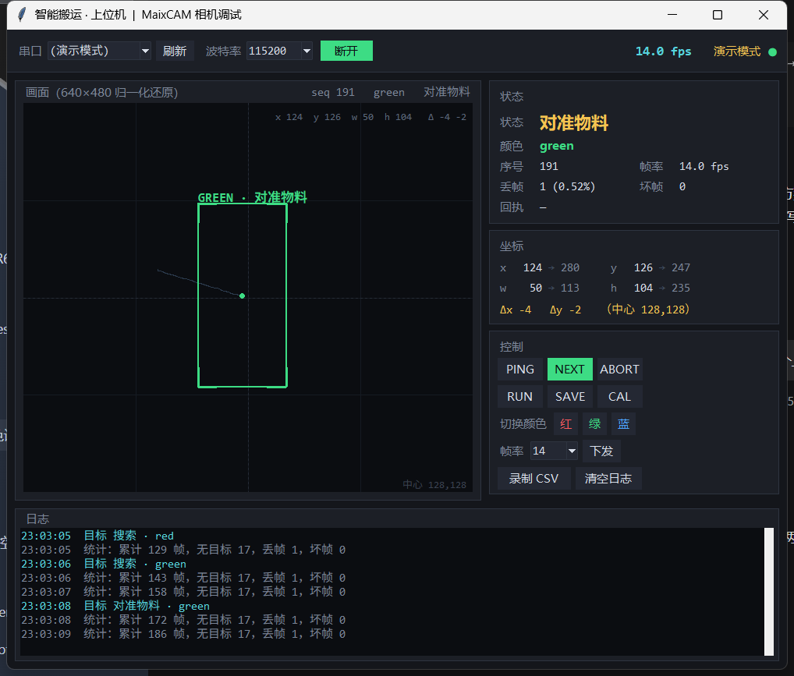

# MaixCAM 颜色物块追踪 —— 相机 + 主控联调工程

智能搬运比赛项目：**相机负责"看"，STM32 负责"动"**。

相机识别目标颜色的物块，把"是否存在 / 颜色 / 中心位置 / 尺寸"按归一化比例打包成串口帧，
STM32 拿去做"居中 + 抵近"，靠近到可以抓取的位置后下爪。

- 协议定稿：[相机_主控串口通信协议_定稿.md](相机_主控串口通信协议_定稿.md)
- 硬件：MaixCAM（SG2002）+ STM32H723ZGT6

---

## 1. 目录结构

```
E:\maxican\
├─ 相机_主控串口通信协议_定稿.md        协议定稿（唯一基准，三套实现都对齐它）v3.0
├─ 现场使用手册.md                      **装到车上真正跑起来的操作手册（先看这个）**
├─ 搬运任务模式.md                      **比赛规则对照 + 搬运模式用法（任务码/两批流程/标定）**
├─ 现场测试清单.md                      **上机实测的分阶段流程（每步都有通过标准）**
├─ 附件1-智能搬运比赛规则1018 (1).docx   比赛规则原文
├─ device_test_report.md                真机验证报告（实测数据、踩坑记录）
├─ README.md                            本文件
├─ camera\
│   ├─ maixcam_color_tracker.py         相机端主程序（MaixPy，单文件，唯一源文件）
│   ├─ vision_selftest.py               真机自检：用标准色图验证环/块判定
│   ├─ probe_shape.py                   形状判据探针（density/solidity/roundness）
│   ├─ probe_api.py                     MaixPy 接口能力探针
│   ├─ bench_probe.py                   性能分解
│   └─ uart1_selftest.py               UART1 收发自检（回环/监听）
├─ app\
│   ├─ build_app.ps1                    打包脚本：把上面的源码复制成应用包
│   ├─ make_icon.py                     生成菜单图标
│   └─ color_tracker\                   应用包（app.yaml + main.py + app.png）
├─ pc\
│   ├─ protocol.py                      协议纯逻辑（组帧/解帧/流式解析，无依赖）
│   ├─ ground_station.py                **上位机图形界面**（实时画面框/状态/命令/CSV）
│   ├─ serial_monitor.py                上位机命令行版（CH340 联调用）
│   ├─ serial_capture.ps1               不依赖 pyserial 的串口抓包（.NET 串口）
│   ├─ field_test.ps1                   **现场一键工具**（部署/运行/拉图/改配置/重启）
│   └─ make_ring_test.py                生成环/块标准色图（给 vision_selftest 用）
├─ stm32\
│   ├─ mx_protocol.h                    主控侧协议接口（纯 C，不依赖 HAL）
│   ├─ mx_protocol.c                    主控侧协议实现（流式解析 + 组帧）
│   └─ host_test.c                      PC 端单元测试（gcc 就能跑）
└─ tests\
    ├─ test_protocol.py                 Python 跨实现一致性测试
    ├─ test_mission.py                  搬运任务逻辑（状态机/形状判定/配置）
    ├─ test_vision_sim.py               视觉链路仿真（假图像跑真代码）
    ├─ fake_camera.py                   模拟 MaixPy image 的假相机
    └─ ring_test.png                    标准色图
```

同一份协议有**三套独立实现**（相机端 Python / 上位机 Python / 主控 C），
测试以协议文档里的示例帧为唯一基准逐个比对，防止"看起来都发了，就是对不上"。

---

## 2. 接线

| MaixCAM | 方向 | STM32H723 |
| --- | --- | --- |
| `A19`（UART1_TX） | → | 所选 USART 的 `RX` |
| `A18`（UART1_RX） | ← | 所选 USART 的 `TX` |
| `GND` | — | `GND`（必须共地） |

- 双方都是 3.3V TTL，**直连即可**，不要接 5V。
- ⚠ **不要用 UART0**（`A16`/`A17`，`/dev/ttyS0`）：那是系统终端与开机日志串口，
  而且 `A16` 是芯片启动模式检测脚，**被外部拉低会导致 MaixCAM 开不了机**。
- MaixCAM 的 USB 口是 USB 网络/存储功能，不是 USB 转串口，不能当串口用。

---

## 3. 部署相机端

### 3.1 跑起来

1. 用 MaixVision 打开 `camera/maixcam_color_tracker.py`，直接运行。
2. 屏幕上会显示当前追踪颜色、`xn/yn/wn/hn` 归一化值、帧率和帧序号，方便肉眼确认。
3. 退出程序后系统会自动回到桌面启动器，**不会黑屏**。

程序上电默认按 `CONFIG["default_color"]`（默认红）持续上报，
收到主控的 `SET_COLOR` 后立即切换；`SAVE` 命令会把颜色和帧率写进
`/root/color_tracker_cfg.json`，掉电保留。

程序支持在设备上（SSH）直接用命令行参数覆盖配置，便于分阶段上机调试：

```bash
python3 -u maixcam_color_tracker.py                      # 正常跑
python3 -u maixcam_color_tracker.py --duration 15        # 跑 15 秒后自动优雅退出
python3 -u maixcam_color_tracker.py --no-display         # 不开屏幕（SSH 调试推荐）
python3 -u maixcam_color_tracker.py --no-uart            # 不开串口（只验视觉）
python3 -u maixcam_color_tracker.py --test-full          # 全范围阈值自检几何换算
python3 -u maixcam_color_tracker.py --color green --fps 20
```

> **为什么要有 `--duration`**：设备上**没有 `timeout` 命令**（BusyBox 未编入），
> 而且不要用 `SIGKILL` 打断正在用摄像头的程序（容易把 ISP/VI 驱动留在半开状态）。
> 让程序自己退，才能走正常流程、干净释放驱动。

### 3.2 用 SSH 上机（USB 虚拟网卡）

设备插上 USB 后是一块虚拟网卡，**设备 IP = 电脑 IP 最后一段改成 1**：

| 网卡 | 电脑 | 设备 |
| --- | --- | --- |
| `UsbNcm Host Device` | 10.171.126.100 | **10.171.126.1** |
| `Remote NDIS based Internet Sharing Device` | 10.171.127.100 | **10.171.127.1** |

两个地址任选其一，默认用户/密码都是 `root`。上传与运行：

```powershell
scp camera\maixcam_color_tracker.py root@10.171.126.1:/root/
ssh -n root@10.171.126.1 "python3 -u /root/maixcam_color_tracker.py --duration 15 --no-display --no-uart"
```

⚠ **要开屏幕，必须先停启动器**，否则 `display.Display()` 会卡住，
并且会把 `/proc` 读取一起堵死（`ps`、`killall` 全部挂起），只能重启设备恢复：

```powershell
ssh -n root@10.171.126.1 "killall launcher_daemon launcher maixvision_server ; sleep 3 ; nohup python3 -u /root/maixcam_color_tracker.py --duration 12 --no-uart > /tmp/t.log 2>&1 < /dev/null &"
# 恢复界面
ssh -n root@10.171.126.1 "sync ; sleep 1 ; /sbin/reboot -f"
```

（MaixVision 连接设备时也是先让启动器退出，只是它自动帮你做了。）

> 两个 Windows 侧的小坑：`ssh` 在 PowerShell 5.1 下会等 stdin 不返回，**加 `-n`**；
> 远程命令别带双引号，PS 5.1 会把它们吃掉。

### 3.3 真机实测结果

见 [device_test_report.md](device_test_report.md)。摘要：

| 测试 | 结果 |
| --- | --- |
| 视觉链路 640×480 | ~29.5 fps（受程序 30fps 节流上限限制），无异常 |
| 几何自检 `--test-full` | 整幅画面 → `xn=128 yn=128 wn=255 hn=191`，**与协议推导值逐项吻合** |
| 串口 `/dev/ttyS1` | 8 秒发送 232 帧，坏帧 0，A19/A18 的 pinmap 正常 |
| 退出 | 每次都打印 `maix multi-media driver released.`，驱动正确释放 |

### 3.4 标定颜色阈值（**必须做，别跳过**）

代码里 `THRESHOLDS` 的红/绿/蓝是 **MaixPy 官方文档给的入门值**，
实机上光照一变就不准，一定要重新标。用设备**自带的「找色块」应用**最快：

1. 打开设备上的「找色块」应用；
2. 摄像头对准物块，**点屏幕上的物块**，左侧会显示该颜色的 LAB 值和矩形框；
3. 点那个矩形框 → 自动生成阈值；再进配置模式手动微调 L/A/B 的 min/max；
4. 把得到的 6 个数字按 `[L_min, L_max, A_min, A_max, B_min, B_max]` 填进 `THRESHOLDS`。

> **更正一处我之前的说法**：我早前说"红色在 LAB 里色相跨界、阈值要拆成两段"——
> 那是把 HSV 色相环的经验错套到 LAB 上了。MaixPy 用的 LAB 里红色是 A 通道的正大值，
> **单段就够了**（官方给的就是 `[[0,80,40,80,10,80]]`）。要拆两段的情况是同一个颜色
> 因光照分裂成明暗两簇，那时才需要多段。

其他可调项在 `CONFIG` 里：分辨率、`pixels_threshold`（滤小噪点）、发送帧率、串口设备与引脚。

### 3.5 开机自启（已部署到设备并实测通过）

设备上的开机自启是**读一个文件**决定的（`launcher_daemon` 与 `settings` 两个二进制里
都有 `/maixapp/auto_start.txt` 这个路径和 `get_curr_auto_start_app` 函数）：

```
/maixapp/auto_start.txt   ← 内容就是"开机要启动哪个应用的 id"
```

官方两条路都通：设备上 `设置 → 开机启动` 里选应用，或手动写这个文件。

前提是它得是个**应用**（不能是裸 `.py`）。应用目录结构（照设备上已有的 `camera001` 来）：

```
/maixapp/apps/color_tracker/
├─ app.yaml      id / name / icon / desc
├─ app.png       菜单图标（128x128）
└─ main.py       入口程序
```

本地把源码打包成应用（**唯一源文件始终是** `camera\maixcam_color_tracker.py`）：

```powershell
powershell -ExecutionPolicy Bypass -File app\build_app.ps1
```

部署 + 开启自启 + 重启：

```powershell
scp -r app\color_tracker root@10.171.126.1:/maixapp/apps/
ssh -n root@10.171.126.1 "printf color_tracker > /maixapp/auto_start.txt"
ssh -n root@10.171.126.1 "sync ; sleep 1 ; /sbin/reboot -f"
```

关闭自启：`ssh -n root@10.171.126.1 "rm -f /maixapp/auto_start.txt"`

**实测结果**（重启后确认）：

| 检查项 | 结果 |
| --- | --- |
| 进程 | `298 root python3 /maixapp/apps/color_tracker/main.py auto_start` |
| 摄像头 / 屏幕 / 串口 | `/proc/298/fd` 里 `/dev/cvi-vi`、`/dev/cvi-vo`、**`/dev/ttyS1`（fd 7）全部打开** |
| 帧率 | 稳定 ~29.5fps，`seq` 持续递增并多次回绕 → 帧在持续发送 |
| 应用日志 | 实时写入 `/maixapp/tmp/last_run.log` |
| 设备是否卡死 | 否，`ps` 正常（**说明由启动器启动时它会正常让出屏幕**，不会像 SSH 直跑那样死锁） |

> **为什么日志能实时看到**：被启动器拉起时 stdout 不是终端，Python 默认块缓冲，
> 日志会卡在缓冲区里、现场排障时一片空白。程序启动时就执行了
> `sys.stdout.reconfigure(line_buffering=True)` 强制行缓冲，所以
> `tail -f /maixapp/tmp/last_run.log` 能实时看到识别结果。

**四个实际要注意的点**：

1. **自启之后 MaixVision 连不上设备**（应用占着摄像头和屏幕）。要改代码就先
   `rm /maixapp/auto_start.txt` 或 SSH 进去 `kill` 掉进程，重启后再改。
2. **自启版本不要带 `--duration`**，否则程序跑一会儿自己退出。
3. **默认颜色要先持久化**：改 `CONFIG["default_color"]` 后重新部署，或者让主控发一次
   `SAVE` 命令（会写 `/root/color_tracker_cfg.json`，上电自动读）。默认是红色。
4. 设备上**没有 `timeout` 命令**，别指望用它限时。

在设备上手动退出应用：按一下机身的功能键（`user` 键）→ 程序 `app.need_exit()` 返回
→ 启动器菜单会回来。

---

## 4. 上位机（接 STM32 之前先验证相机和线）

一根 CH340 接相机的 A19(TX)，电脑上就能看到相机"现在盯着谁、对准了没有"。
两个版本，**图形界面看现场，命令行版做批量抓包**。

### 4.1 图形界面（推荐）

```powershell
pip install pyserial
python pc\ground_station.py                 # 打开界面，选串口点连接
python pc\ground_station.py --port COM5     # 启动即连接
python pc\ground_station.py --demo          # 演示模式：不接任何硬件
```



界面分三块：

| 区域 | 内容 |
| --- | --- |
| 左 | 把归一化坐标还原成画面框，**按颜色上色**，带移动轨迹；无目标时显示"搜索中" |
| 右·状态 | 状态机阶段 / 颜色 / 序号 / 帧率 / 丢帧 / 坏帧 / **最近回执** |
| 右·坐标 | x y w h 的 `归一化值 → 画布像素`，以及相对中心的偏差 Δx Δy |
| 右·控制 | PING / NEXT / ABORT / RUN / SAVE / CAL / 切颜色 / 设帧率 / 录 CSV |
| 下 | 日志：状态变化、下发命令的十六进制、**相机的 OK / FAIL 回执** |

几个细节：

- **回执会单独显示。** 相机每收到一条命令都回一帧 `CC CC DD DD`，和数据帧走同一根线。
  上位机用 `MixedParser` 同时认这两种帧头，所以命令到底成功没有，日志里一眼可见
  （比如搬运模式下按 CAL 会明确显示 `CALIBRATE FAIL`）。
- **帧率是把"每秒收到多少帧"算出来的**，能直接看出相机是不是跑不动了。
- **丢帧按序号推算**，坏帧是校验和/帧尾不对的次数 —— 这两个数一涨就是接线或波特率的问题。
- **录制 CSV** 存到 `captures\gs-时间.csv`，离线复盘用（Excel 直接打开）。
- 画面区会跟着窗口缩放，归一化坐标铺满不留白。

`--demo` 模式自己造一整套搬运周期（搜索→对准→可抓→对准目标区→可放→完成），
没有相机也能把界面和流程跑通，给老师演示很方便。

### 4.2 命令行版

不想开窗口、或者要长时间抓包时用它：

```powershell
python pc\serial_monitor.py --list                      # 找串口号
python pc\serial_monitor.py --port COM5                 # 监听
python pc\serial_monitor.py --port COM5 --color green --repeat
```

`--repeat` 会每 200ms 重发一次启动命令，直到收到相机第一帧 —— 对应"相机开机十几秒、
主控早就上电了"的真实场景。

不想接硬件也能先验证工具本身：

```powershell
python pc\serial_monitor.py --simulate --duration 5
```

模拟模式会自己造帧，还会**故意插入噪声字节和一个校验和错误帧**，
用来证明解析器能重新同步、坏帧计数正确。

运行中可以直接敲命令（回车执行）：

| 输入 | 作用 |
| --- | --- |
| `r` / `g` / `b` | 切换追踪红 / 绿 / 蓝 |
| `run` / `stby` | 运行 / 待机 |
| `fps 30` | 设置相机发送帧率 |
| `ping` | 链路自检 |
| `save` | 让相机保存当前配置 |
| `q` | 退出 |

输出长这样（`dx/dy` 是相对画面几何中心的偏差，正=偏右/偏下）：

```
seq=  8  TARGET green  xn=125( 49.0%) yn=199( 78.0%)  wn= 51 hn= 43  dx=  -3 dy= +71
  ── 速率 30.1 帧/秒   累计 305 帧   无目标 12   丢帧 0   坏帧 0
```

结束时打印累计帧数、无目标帧数、丢帧数、校验失败数。

---

## 5. 接入 STM32

### 5.1 把协议文件加进工程

把 `stm32/mx_protocol.h`、`stm32/mx_protocol.c` 加进你的工程即可，**它不依赖 HAL**，
只用 `<string.h>`，可以在任何 STM32 工程里直接用。

### 5.2 用 DMA + 空闲中断收帧（推荐）

H723 上最省 CPU 的写法：让 DMA 收一整段，再喂进状态机。

```c
#include "mx_protocol.h"

static mx_parser_t  g_parser;
static uint8_t      g_rx_buf[64];
static mx_uplink_t  g_last;               /* 最新一帧 */
static volatile uint8_t  g_new_frame;
static volatile uint32_t g_last_frame_ms;
static uint8_t      g_center_x = 141;     /* ← 标定后填入，不要用 128 */
static uint8_t      g_center_y = 118;     /* ← 标定后填入 */
static uint8_t      g_grab_w_n = 150;     /* ← 标定后填入 */

void app_camera_init(void)
{
    mx_parser_init(&g_parser);
    /* 用 ReceiveToIdle_DMA，空闲中断会回调 RxEventCallback */
    HAL_UARTEx_ReceiveToIdle_DMA(&huart1, g_rx_buf, sizeof(g_rx_buf));
    /* 关键：关掉"半传输中断"，否则缓冲区收一半也会回调，容易重复处理 */
    __HAL_DMA_DISABLE_IT(&hdma_usart1_rx, DMA_IT_HT);
}

/* 空闲中断触发：Size 是本次收到的字节数 */
void HAL_UARTEx_RxEventCallback(UART_HandleTypeDef *huart, uint16_t Size)
{
    if (huart->Instance == USART1) {
        for (uint16_t i = 0; i < Size; i++) {
            mx_uplink_t f;
            if (mx_parser_feed(&g_parser, g_rx_buf[i], &f)) {
                g_last = f;
                g_last_frame_ms = HAL_GetTick();
                g_new_frame = 1;
            }
        }
        HAL_UARTEx_ReceiveToIdle_DMA(huart, g_rx_buf, sizeof(g_rx_buf));
    }
}

/* 下发命令 */
void camera_set_color(uint8_t color)
{
    uint8_t frame[MX_DOWN_FRAME_LEN];
    mx_build_downlink(MX_CMD_SET_COLOR, color, frame);
    HAL_UART_Transmit(&huart1, frame, MX_DOWN_FRAME_LEN, 20);
}

/* 主循环 */
void app_camera_task(void)
{
    static uint32_t t_retry = 0;
    static uint8_t  camera_alive = 0;

    /* 1) 上电重传：相机开机十几秒，命令会丢，所以周期重发直到收到第一帧 */
    if (!camera_alive && HAL_GetTick() - t_retry >= 200) {
        t_retry = HAL_GetTick();
        camera_set_color(MX_COLOR_RED);
        uint8_t frame[MX_DOWN_FRAME_LEN];
        mx_build_downlink(MX_CMD_PING, 0, frame);
        HAL_UART_Transmit(&huart1, frame, MX_DOWN_FRAME_LEN, 20);
    }

    /* 2) 超时保护：超过 100ms 没有有效帧 -> 判定相机掉线，立即停车 */
    if (HAL_GetTick() - g_last_frame_ms > 100) {
        chassis_stop();
        camera_alive = 0;
        return;
    }
    camera_alive = 1;

    if (!g_new_frame) {
        return;
    }
    g_new_frame = 0;

    /* 3) 目标丢了就停车等着，绝不要沿用旧坐标 */
    if (!g_last.exists) {
        chassis_stop();
        return;
    }

    /* 4) 居中 + 抵近 */
    int dx = mx_dx(&g_last, g_center_x);   /* >0 偏右 */
    int dy = mx_dy(&g_last, g_center_y);   /* >0 偏下 */

    if (dx >  4) chassis_turn_right();
    if (dx < -4) chassis_turn_left();
    if (dy >  4) chassis_forward();
    if (dy < -4) chassis_backward();

    /* 5) 对准且足够近 -> 下爪 */
    if (dx >= -4 && dx <= 4 && dy >= -4 && dy <= 4 && g_last.w_n >= g_grab_w_n) {
        chassis_stop();
        gripper_close();
    }
}
```

> 上面是骨架，`chassis_*` / `gripper_*` 换成你自己的函数。
> 完整控制说明见协议文档第 5 节。

---

## 6. 跑测试

### 6.1 主控 C 代码

```powershell
cd stm32
gcc -std=c99 -Wall -Wextra -o host_test.exe host_test.c mx_protocol.c
.\host_test.exe
```

覆盖：文档示例帧、逐字节喂入、噪声、坏帧重同步、假帧头恢复、粘包、
下行组帧与回执、校验和溢出。

### 6.2 Python 跨实现一致性

```powershell
python tests\test_protocol.py
```

覆盖：三套实现的组帧字节比对、校验和一致、流式解析、归一化换算、
色块转帧、阈值表合法性、上位机命令映射、模拟模式与相机端换算一致、
**混合流解析（数据帧+回执帧）、上位机画面换算、演示数据源**。

**当前状态**：

| 测试 | 断言数 |
| --- | --- |
| `tests/test_protocol.py` | 308 |
| `tests/test_mission.py` | 220 |
| `tests/test_vision_sim.py` | 44 |
| `stm32/host_test.c`（gcc） | 43 |
| **合计** | **615** |

---

## 7. 已知限制与待办

| 项 | 状态 |
| --- | --- |
| 颜色阈值 | **入门值，必须实机重新标定**（用设备自带「找色块」应用） |
| `CENTER_X` / `CENTER_Y` | **空值待标定**：相机光心与爪子中心不重合，必须在抓取高度上标一次 |
| `GRAB_W_N` | **空值待标定**：能稳定抓住时的 `w_n` |
| 画面分辨率 | 默认 640×480，可改；协议已归一化，改分辨率不影响主控。若你的摄像头模组不支持该分辨率（有些只给 320×240 / 1280×720），直接改成支持的值即可 |
| GPIO 硬急停 | **协议已定义但未启用**，引脚待实机确认（避开 A16/A17/A18/A19） |
| 透视校正 | 相机与爪子平行安装，**不需要**；若日后改斜装，需在相机内做四角标定 |
| 多色同时识别 | 不支持，一次只追一色（协议按此设计） |
| pyserial | 当前环境未安装，真实串口模式需要先装 |
| 相机端代码 | **已在真机跑通**（MaixCAM / SG2002 / MaixPy 4.8.2），视觉链路 ~29.5fps、几何换算逐值吻合、串口发送正常、退出干净 |
| 电气链路 | **未验证**：`A19`→STM32 RX、`A18`←STM32 TX、共地，需接上主控或用 CH340 抓包确认 |
| 下行指令双向联调 | **未在真机验证**（逻辑已被单元测试覆盖），需要 PC 或 STM32 往 `ttyS1` 发帧 |
| 长时间稳定性 | 只跑过 8~15 秒短测，未做长时间连续运行观察 |
